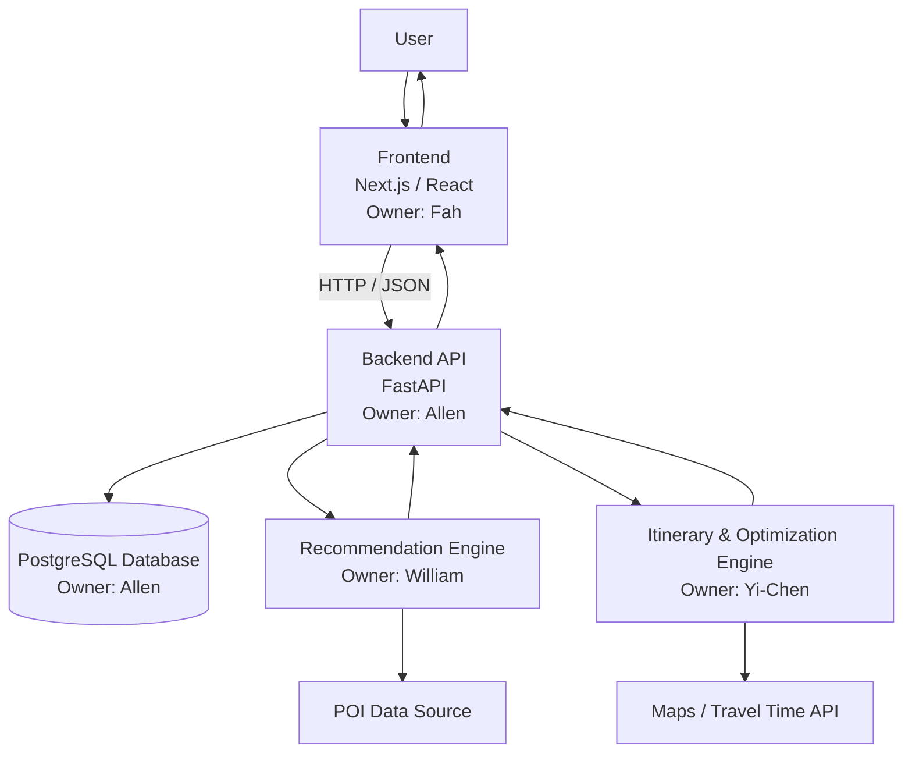

# AI Travel Planner - System Architecture

## 1. Architecture Goal

The goal of the system architecture is to define how the major components of the
AI Travel Planner communicate with each other.

The system should support the following main flow:

User Input
→ Travel Preferences
→ Personalized POI Recommendation
→ Itinerary Generation
→ Route / Constraint Optimization
→ Itinerary and Map Display
→ Save Trip

---

## 2. High-Level Architecture



---

## 3. System Components

### 3.1 Frontend

**Technology**
- Next.js
- React
- Tailwind CSS

**Owner**
- Fah

**Responsibilities**
- Display user interface
- Collect trip information
- Collect travel preferences
- Display recommended POIs
- Display generated itinerary
- Display map
- Allow users to save and view trips

### Main Input

- Destination
- Number of travel days
- Budget
- Transportation
- Travel pace
- Travel interests

### Main Output

The frontend sends structured JSON requests to the backend.

Example:

```json
{
  "destination": "Tokyo",
  "days": 3,
  "budget": "medium",
  "transportation": "public_transport",
  "pace": "normal",
  "interests": [
    "food",
    "culture",
    "shopping"
  ]
}
```

---

## 3.2 Backend API

**Technology**
- FastAPI
- Python

**Owner**
- Allen

**Responsibilities**
- Receive requests from the frontend
- Validate user input
- Communicate with the database
- Send user preferences to the recommendation engine
- Send ranked POIs to the optimization engine
- Return itinerary results to the frontend
- Save and retrieve trip information

The backend acts as the main communication layer between all system components.

---

## 3.3 Database

**Technology**
- PostgreSQL
- SQLAlchemy

**Owner**
- Allen

**Main Data**

The database stores:

- Users
- User preferences
- Trips
- POIs
- Itinerary items

### Main Tables

```text
users
preferences
trips
pois
itinerary_items
```

Example relationship:

```text
User
 ↓
Preference

User
 ↓
Trip
 ↓
Itinerary Item
 ↓
POI
```

---

## 3.4 Recommendation Engine

**Owner**
- William

**Purpose**

Answer the question:

> WHERE should the user go?

**Input**
- User interests
- Budget
- Travel preferences
- Available POIs

**Processing**

The recommendation engine calculates a recommendation score for each POI.

Initial MVP approach:

- Content-Based Recommendation
- Weighted Scoring

Possible factors:

- Interest match
- Rating
- Budget match
- Category match

**Output**

The recommendation engine returns ranked POIs.

Example:

```json
[
  {
    "poi_id": 101,
    "name": "Tsukiji Outer Market",
    "recommendation_score": 0.94,
    "reason": "Strong food preference match"
  },
  {
    "poi_id": 102,
    "name": "Senso-ji",
    "recommendation_score": 0.89,
    "reason": "Strong culture preference match"
  }
]
```

The recommendation result is passed to the backend and then to the itinerary /
optimization engine.

---

## 3.5 Itinerary and Optimization Engine

**Owner**
- Yi-Chen

**Purpose**

Answer the questions:

> WHEN should the user visit each POI?

and

> IN WHAT ORDER should the user visit the POIs?

### Input

The optimization engine receives:

#### Trip Information

- Number of travel days
- Daily start time
- Daily end time
- Transportation
- Travel pace

#### POI Information

- POI ID
- Name
- Latitude
- Longitude
- Opening hours
- Stay duration
- Recommendation score

Example:

```json
{
  "days": 3,
  "daily_start_time": "09:00",
  "daily_end_time": "21:00",
  "transportation": "public_transport",
  "pace": "normal",
  "pois": [
    {
      "poi_id": 101,
      "name": "Tsukiji Outer Market",
      "latitude": 35.6655,
      "longitude": 139.7707,
      "opening_hours": "08:00-14:00",
      "stay_duration": 90,
      "recommendation_score": 0.94
    }
  ]
}
```

### Constraints

The optimizer should consider:

- Opening hours
- Stay duration
- Travel time
- Daily available time
- Number of travel days
- Transportation

### Objective

The optimizer should attempt to:

- Maximize recommendation value
- Reduce unnecessary travel time
- Avoid time conflicts
- Respect opening hours
- Produce a reasonable travel order

### Output

Example:

```json
{
  "days": [
    {
      "day": 1,
      "items": [
        {
          "poi_id": 101,
          "name": "Tsukiji Outer Market",
          "start_time": "09:00",
          "end_time": "10:30",
          "travel_time_to_next": 20
        }
      ]
    }
  ]
}
```

---

## 3.6 Maps / Travel Time Service

Possible services:

- Google Maps Platform
- Mapbox

The map service may provide:

- POI coordinates
- Route information
- Distance
- Travel time

The optimization engine may use travel-time information to determine a reasonable
POI visiting order.

---

## 3.7 POI Data

POI data is required by both:

- Recommendation Engine
- Optimization Engine

Required fields:

```text
id
name
category
latitude
longitude
rating
price_level
opening_hours
stay_duration
tags
```

For the first prototype, the system can use a small Tokyo seed dataset.

Later, external POI APIs may be integrated.

---

# 4. Main Data Flow

The complete data flow is:

```text
1. User
   ↓

2. Frontend
   User enters:
   - Destination
   - Days
   - Budget
   - Transportation
   - Pace
   - Interests
   ↓

3. Backend
   Validate and process request
   ↓

4. Recommendation Engine
   User Preferences + POI Data
   ↓
   Ranked POIs
   ↓

5. Backend
   ↓

6. Itinerary / Optimization Engine
   Ranked POIs
   + Opening Hours
   + Stay Duration
   + Travel Time
   + Trip Constraints
   ↓
   Optimized Itinerary
   ↓

7. Backend
   Save itinerary to database
   ↓

8. Frontend
   ↓

9. User sees:
   - Recommended POIs
   - Daily itinerary
   - Map
```

---

# 5. Module Communication

The main communication format between components will be:

```text
HTTP + JSON
```

Example:

```text
Frontend
     ↓
   JSON
     ↓
FastAPI Backend
     ↓
Recommendation Engine
     ↓
FastAPI Backend
     ↓
Optimization Engine
     ↓
FastAPI Backend
     ↓
Frontend
```

The frontend should not communicate directly with the recommendation or
optimization engine.

All requests should pass through the backend.

---

# 6. Team Responsibilities

| Member | Main Responsibility |
|---|---|
| Fah | UI/UX + Frontend |
| Allen | Backend + Database |
| William | Recommendation System + POI Data |
| Yi-Chen | Itinerary + Optimization + System Integration / Coordination |

---

# 7. Architecture Principle

For the November MVP, the system will use a simple modular architecture.

We will avoid unnecessary complexity such as:

- Microservices
- Kubernetes
- Multiple independent backend services
- Training a large language model from scratch

The priority is:

1. Clear module responsibilities
2. Stable data interfaces
3. Easy integration
4. Easy testing
5. Demo-ready system by November 30

---

# 8. Architecture Definition of Done

The System Architecture task is complete when:

- [ ] Frontend responsibilities are defined
- [ ] Backend responsibilities are defined
- [ ] Database responsibilities are defined
- [ ] Recommendation Engine responsibilities are defined
- [ ] Optimization Engine responsibilities are defined
- [ ] Main data flow is documented
- [ ] Module communication method is defined
- [ ] Team ownership is documented
- [ ] Recommendation output can be used by the optimizer
- [ ] Optimizer output can be returned to the frontend
- [ ] Fah, Allen, William, and Yi-Chen review and agree on the architecture
