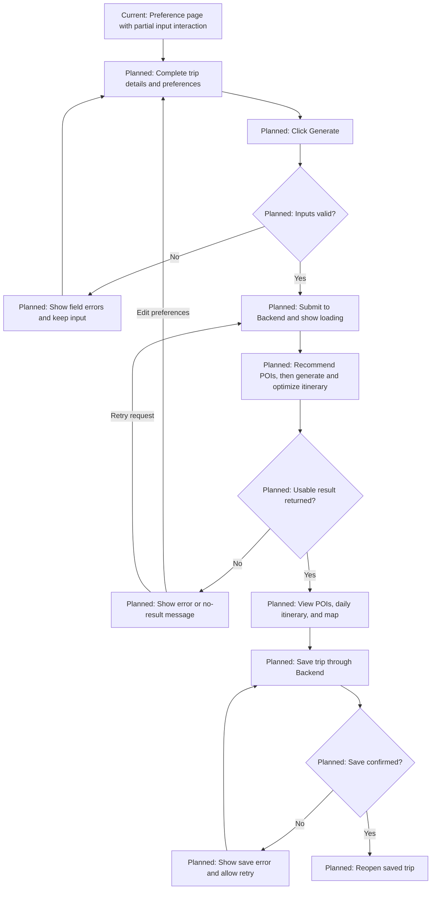

# Week 1 User Flow

## 1. Purpose

Define the user journey for Week 1 Design & Setup, starting from Fah's actual
Preference page and showing the planned MVP continuation. This document describes
design scope; it does not claim that the complete MVP is implemented.

Sources verified on 2026-10-20:
- Frontend branch `feature/travel-preference`, commit `8f165c1304ef2e7c1dcc66a13f6d4271033ba244`:
  [page.tsx](https://github.com/Yi-Chen-Lin-dev/AI-Travel-Planner/blob/8f165c1304ef2e7c1dcc66a13f6d4271033ba244/frontend/app/page.tsx) and
  [PreferenceForm.jsx](https://github.com/Yi-Chen-Lin-dev/AI-Travel-Planner/blob/8f165c1304ef2e7c1dcc66a13f6d4271033ba244/frontend/components/PreferenceForm.jsx).
- [MVP Requirements](MVP_REQUIREMENTS.md), [System Architecture](ARCHITECTURE.md),
  and [Data Contract](DATA_CONTRACT.md), read on `Yi-Chen-Lin-dev-patch-1`
  at commit `f51508471e4102f2415c86ef06e5359497f892f9`.

Current behavior below is verified from source code, not a browser test.
Use Data Contract field names where older architecture examples differ.

## 2. Current Implemented Frontend Flow

1. Open the home page. `frontend/app/page.tsx` loads `PreferenceForm`.
2. View **Set Trip Preferences**, the only implemented user screen in this prototype.
3. Edit Destination and select Budget, Travel Styles, Primary Transit, and Trip Pacing.
   Changes update local React state and selected styles.
4. View fixed dates and duration. The date cards and **Edit** text do not edit dates.
5. Reach **Generate Intelligent AI Trip (4D3N)**. It has no submit handler or API call,
   so the flow ends here without a result or navigation.

The sections are on one page, not separate screens. Local state is not saved trip data.

## 3. Planned MVP User Flow — Not Yet Implemented End to End

1. **Create trip and enter preferences:** extend the existing page with working dates,
   duration, contract-compatible values, and validation.
2. **Generate:** submit valid preferences to the Backend and show a loading state.
3. **Recommend POIs:** the Backend requests ranked places with scores and reasons.
4. **Generate and optimize itinerary:** the Backend passes joined POI data and trip
   constraints to the Optimizer. It assigns days, visit order, and times while
   considering travel time, opening hours, stay duration, and daily available time.
5. **View results:** show recommended POIs, the daily itinerary, and a map with visit order.
6. **Save / view trip:** persist through the Backend and reopen the saved itinerary.

These are planned journey stages, not existing routes or a requirement for one
screen per stage. Result layout and navigation still need design. Save/reopen is
required by the MVP; the exact save trigger (explicit action or automatic persistence)
still needs agreement. Static auto-save text does not establish that behavior.
Keep the MVP exclusions in MVP Requirements; this flow adds no booking, chatbot,
social, or dynamic replanning features.

## 4. MVP Journey Flowchart

Only the first node represents the current page. All later behavior is planned.

## 5. Current Preference Page: Screen and Input Details

| Section | Current content and interaction | Planned contract alignment |
|---|---|---|
| Destination | Editable text; initial value is `Taipei, Taiwan — Confirmed TW`. Popular-city chips and “Change city anytime” have no handlers. | Send a validated city/area as `destination`; the “Confirmed” text is not validation. |
| Travel Dates & Duration | Fixed 18–21 Sep 2025 and “Total 4 Days 3 Nights”. `startDate` / `endDate` exist in state, but cards are static and Edit has no handler. | Collect real dates; send `start_date` and integer `days`. End date is not a contract field. |
| Budget Level | Single selection: Economy, Moderate, Luxury; default Moderate. | Proposed mapping: `economy → low`, `moderate → medium`, `luxury → high`. No mapping code exists yet. Displayed prices are not API budget values. |
| Preferred Travel Style | Multi-select: Cafes & Photo Spots, Night Markets & Street Food, Shopping & Boutiques, Nature & Scenery, History & Ancient Temples, Hot Springs & Wellness. Defaults: cafes, night markets, nature. | Map to `interests`: cafes/night markets → `food`, history → `culture`, shopping → `shopping`, nature → `nature`; deduplicate. Wellness has no defined mapping. |
| Primary Transit | Single selection: MRT / Metro, Public Bus & Walking, Taxi / Uber; default MRT. | Proposed: MRT and Bus → `public_transport`. Taxi/Uber mapping needs agreement; do not silently equate it with `driving`. |
| Trip Pacing | Single selection: Balanced (3–4 spots/day), Slow Travel (1–2 spots/day); default Balanced. | Proposed: `balanced → normal`, `slow → relaxed`. Spot counts are display copy, not an implemented schedule rule. |
| Generate | Visible button; no handler, submission, or navigation. | Validate, submit, show progress, then display the result or an error. |

The contract also supports `entertainment`, `walking`, `driving`, and `fast`;
these are not explicit matching choices in the current UI. It has no controls for
`daily_start_time`, `daily_end_time`, or `timezone`. Their input/default policy
must be agreed before integration.

## 6. Decision Points and Validation — Planned Behavior

These are proposed implementation rules derived from the MVP and Data Contract,
not existing checks in PreferenceForm.

| Decision | Planned response |
|---|---|
| Required trip data missing | Require a non-empty destination, start date, days, budget, transportation, pace, and at least one standardized interest. Obtain daily times and timezone through agreed inputs/defaults. Keep input and explain what is missing. |
| Invalid dates or duration | Reject invalid calendar dates, an end date before the start date, and non-integer or fewer than 1 travel day. If using both dates, propose inclusive duration: same-day trip = 1 day. Confirm this rule before implementation. |
| No interests selected | Ask the user to select at least one interest; do not submit an empty array. |
| Unsupported UI value | Require an agreed contract mapping, especially for Wellness and Taxi/Uber; do not send raw UI values as API enums. |
| Invalid daily time or timezone | Require valid `HH:MM` times, end after start for the planned daily window, and an IANA timezone. |
| Valid frontend input | Send the request; Backend validates again before calling the engines. |
| Waiting for result | Show loading and prevent duplicate submissions. |
| Request fails or no usable itinerary | Keep preferences, explain the problem, and allow retry or editing. Exact error payloads are not defined by the current contract. |
| Save/retrieve fails | Show the failure and allow retry; show saved confirmation only after Backend success. |

## 7. Data Handoff Summary — Planned Integration

Logical flow from Data Contract:

**Frontend → Backend → Recommendation → Optimizer → Backend → Frontend**

The Backend coordinates the engines. Following System Architecture, the actual
handoff includes **Recommendation → Backend → Optimizer**; the frontend never
calls either engine directly.

| Handoff | Data and responsibility |
|---|---|
| Frontend → Backend | HTTP/JSON Trip Preference Input: `destination`, `start_date`, `days`, `budget`, `transportation`, `pace`, `interests`, `daily_start_time`, `daily_end_time`, `timezone`. |
| Backend → Recommendation | Validated preferences and available POI data for ranking. |
| Recommendation → Backend → Optimizer | Recommendation returns `poi_id`, `recommendation_score`, `recommendation_reason`. Backend joins POI details and sends `{ trip, pois }`, including coordinates, weekly `opening_hours`, and `stay_duration_minutes`. |
| Optimizer → Backend | `days[]` with `day`, `date`, and `items[]`: `poi_id`, `visit_order`, `start_time`, `end_time`, `travel_time_to_next_minutes`. |
| Backend → Frontend | Return itinerary and the POI information needed for recommendations and map display. Backend handles database persistence/retrieval. The final response envelope and save/retrieve endpoints still need definition. |

Use UUID strings for IDs, snake_case field names, dates as `YYYY-MM-DD`,
times as `HH:MM`, and durations in minutes. These handoffs are not connected
to the current Generate button.

## 8. Definition of Done for This Document

- [x] Current page and working interactions are traced to the verified prototype.
- [x] Current behavior is separated from planned MVP stages.
- [x] Mermaid journey includes validation, results, and save/reopen.
- [x] Inputs, planned decisions, data handoffs, and current gaps are documented.
- [x] Names follow Data Contract; unresolved mappings and design choices are explicit.
- [ ] Fah, Allen, William, and Yi-Chen review the flow and agree on open choices.

This checklist measures documentation readiness, not feature completion.

## 9. Current Prototype Gaps Versus the Flow

- No working date editor, calculated duration, or daily-time/timezone input policy.
- No contract mapping layer or required-field/date/interest validation.
- No Generate submit handler, Backend request, or connected recommendation/optimization.
- No loading, error, empty-result, or retry flow.
- No implemented recommendation result, itinerary result, or map view.
- No save-trip, saved-trip retrieval, or persistence.
- “Live Sync”, “All requirements verified”, “AI Accuracy 99.4%”, weather text,
  and “Auto-saved to My Trips” are static copy, not evidence of working features.
  Export/share text also does not establish implemented functionality or MVP scope.
